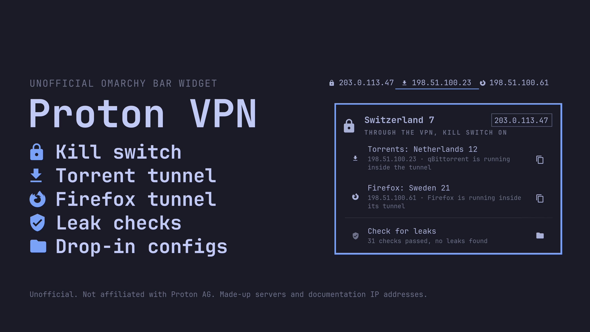
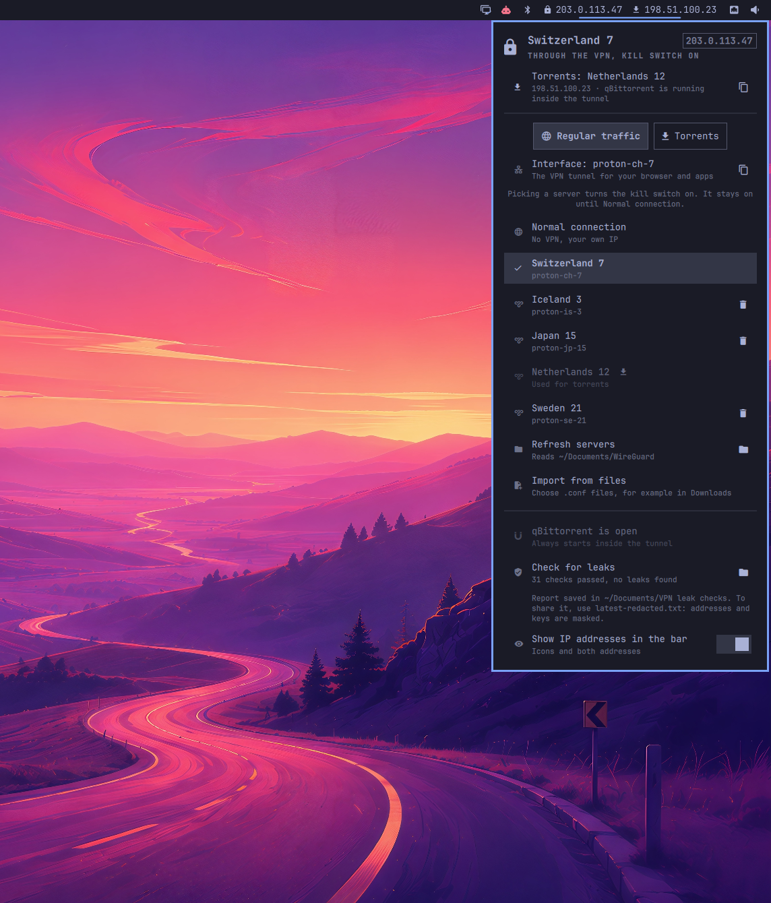
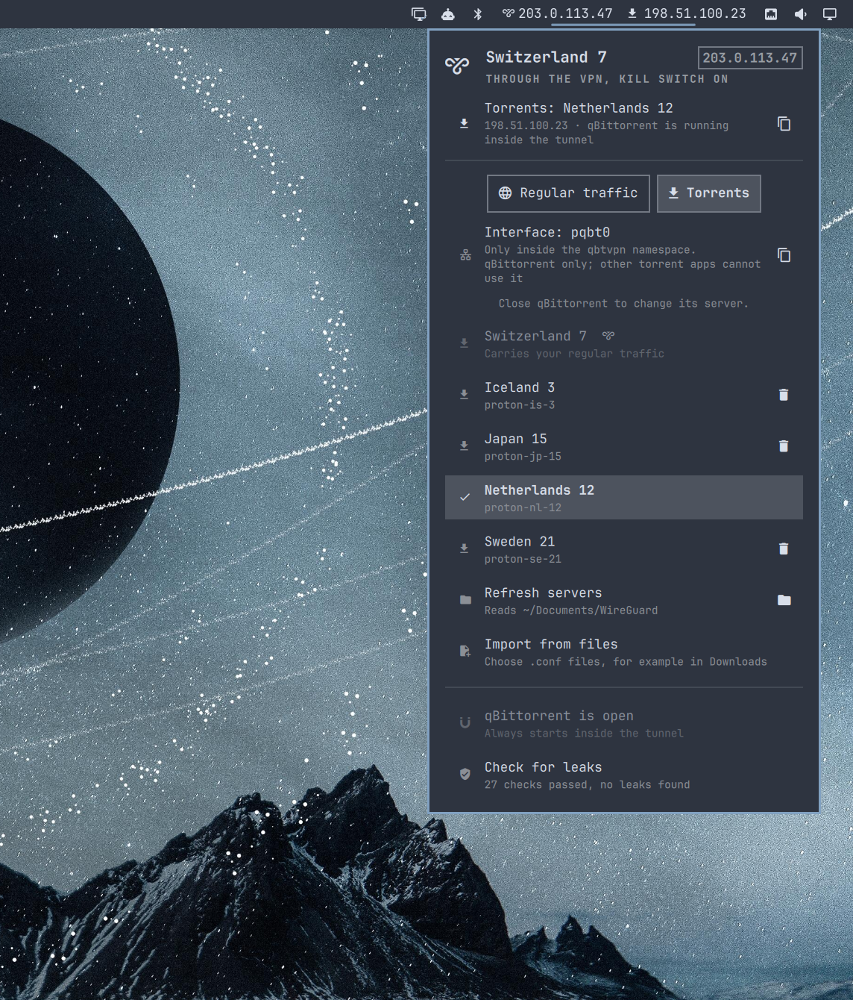
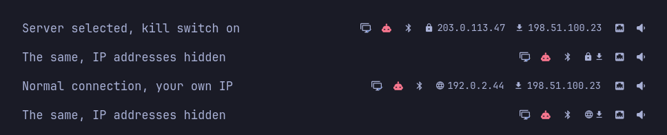
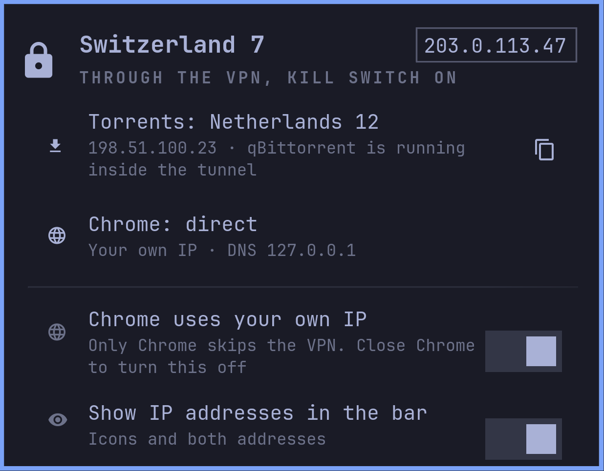

# Proton VPN + Kill Switch + Torrent Tunnel (unofficial)

Proton VPN kill switch, torrent tunnel & leak checks in the [Omarchy](https://omarchy.org/) bar.
An unofficial bar widget for Proton VPN over WireGuard: pick your own IP or a Proton server, the
kill switch is always on while a server is selected, qBittorrent has its own tunnel it cannot
leave, every leak check is saved as a report, and an optional switch keeps Google Chrome on your
own connection while everything else follows the VPN.

Listed in the [Omarchy plugin marketplace](https://plugins.omarchy.org/plugin.html?id=io.github.ralphk-86.omarchy-proton).
Current version: 0.4.2, see the [changelog](CHANGELOG.md).



> Unofficial. This is a community plugin, not affiliated with or endorsed by Proton AG. It
> uses the standard WireGuard configs you download from your own Proton VPN account.

**Install:** open a terminal (<kbd>Super</kbd> + <kbd>Return</kbd>), paste this line, and
press Enter.

```sh
omarchy plugin add https://github.com/ralphk-86/omarchy-proton.git --enable && ~/.config/omarchy/plugins/io.github.ralphk-86.omarchy-proton/install.sh
```

The first half adds the widget to your bar; Omarchy asks you to confirm and where to put it.
The second half sets up the system part: it installs any missing packages from the official
repositories and asks for your password once. It does not connect anything. Then
[add your servers](#add-servers).

Rather read the code before anything runs as root? Run only the first half. The widget then
shows a wrench, and **Finish setup** in its panel does the second half when you are ready.
Details: [Install](#install).

<p>
  
  
</p>

<sub>Screenshots use made-up servers and addresses from the ranges reserved for documentation.</sub>

**Contents:** [Quick start](#quick-start) · [What you choose](#what-you-choose) ·
[How to use it](#how-to-use-it) · [Requirements](#requirements) · [Install](#install) ·
[Add servers](#add-servers) · [How the protection works](#how-the-protection-works) ·
[Chrome direct](#chrome-direct) ·
[Check it, and get out of trouble](#check-it-and-get-out-of-trouble) ·
[Using it with Tailscale](#using-it-with-tailscale) ·
[DNS and Omarchy's DNS setting](#dns-and-omarchys-dns-setting) · [Settings](#settings) ·
[What gets installed](#what-gets-installed) · [Update](#update) · [Uninstall](#uninstall) ·
[Security and privacy](#security-and-privacy) · [Limits](#limits) ·
[Development and tests](#development-and-tests)

## Quick start

1. Paste the install line from the top of this page into a terminal and type your password
   when asked. Missing packages are installed for you. (If you added only the widget: click
   the wrench in the bar and choose **Finish setup**.)
2. Download at least two WireGuard configs from account.protonvpn.com (Downloads > WireGuard
   configuration, platform GNU/Linux): one for your regular traffic, one for torrents.
3. Import them. Either put them all in `~/Documents/WireGuard` and choose **Refresh servers**
   (easiest for several), or choose **Import from files** and pick them wherever they are.
4. On the **Regular traffic** tab pick a server; the kill switch turns on with it. On the
   **Torrents** tab pick the server for qBittorrent. **Normal connection** turns the VPN off.
5. Choose **Check for leaks** once. It should say that every check passed.

Details for each step follow below.

## What you choose

Your regular traffic (browser, apps, everything except qBittorrent, and except Chrome if you
turn on [Chrome direct](#chrome-direct)) goes out one of two ways, and you pick which in the
panel:

- **Normal connection:** your own IP address, no VPN. This is the default, and what you get
  after a reboot.
- **A Proton server:** the server's IP address. Websites see Proton, not you.

**The kill switch is always on while a server is selected.** There is no setting to turn it off:
if the server stops answering, the connection drops, or the machine wakes from sleep before the
VPN is back, your regular traffic is blocked (and you get a notification) instead of going out
through your own address. Choosing **Normal connection** is the only way out of it, and it is
also what a reboot gives you.

The bar always shows which IP your regular traffic is using right now. Torrents are separate:
qBittorrent always uses its own tunnel, whatever you pick for regular traffic, and the bar
shows that IP too.

Two tunnels, on purpose, and one exception you can turn on:

| | Desktop VPN | Torrent tunnel | Chrome direct (optional) |
|---|---|---|---|
| What goes through it | everything you do, when you pick a server | qBittorrent, always | Google Chrome, always on your normal connection |
| Default | off: you are on your normal connection | on from boot | off: Chrome follows the bar like everything else |
| You control it | from the bar panel | you don't; it is never toggled | the panel's **Chrome uses your own IP** switch, or `vpn-direct on`/`off` |
| If it fails | kill switch: traffic is blocked until you pick a server or "Normal connection" | qBittorrent has no network at all | Chrome goes into the VPN or is blocked, never other apps out; the panel says so |

Most setups use one VPN for both jobs, and they conflict: you want to switch the browsing VPN
on and off freely, and you never want torrents to be off it. Here they are independent.
Turning the desktop VPN off, or switching server, does not touch the torrent tunnel.

Built for and tested with Proton VPN. It only relies on standard WireGuard `.conf` files, so
other providers (Mullvad, IVPN, AirVPN, Windscribe, self-hosted) work too; set
`VPNKIT_PROVIDER` for their naming.

## How to use it

**The bar** shows, at a glance, how your regular traffic leaves:

| Icon | Meaning |
|---|---|
| closed lock | through a server, kill switch on |
| globe | your own connection, no VPN |
| alert, urgent colour | blocked by the kill switch (the server is down) |
| open lock, urgent colour | a VPN is up without its kill switch; pick the server again |
| wrench | setup or an update of the system part is needed |



Next to it is the external IP of your regular traffic and, after the download arrow, the exit
IP of the torrent tunnel. **Show IP addresses in the bar**, the last row of the panel, hides
the addresses and leaves only the icons. The bar also turns the urgent colour when the torrent
tunnel is down, and flashes `TORRENT LEAK` if a qBittorrent process is ever found outside its
tunnel. Left-click opens the panel, right-click toggles the VPN, middle-click refreshes.

**The panel**, top to bottom:

| Part | What it does |
|---|---|
| Header | where your regular traffic goes right now, and its IP; "kill switch on" with a server |
| Torrents line | the torrent server, its IP, and whether qBittorrent is running inside the tunnel; the copy icon copies the IP |
| Chrome line | only while [Chrome direct](#chrome-direct) is on: "Your own IP" and the resolver Chrome uses, or the first problem in the urgent colour |
| **Regular traffic / Torrents** | which traffic the list below chooses a server for |
| Normal connection | (Regular traffic tab) your own IP, no VPN; removes the kill switch |
| One row per server | click to use it for the tab you are on; a tick marks the current one. The server the other tab uses is greyed and labelled. The trash icon deletes a server (click twice) |
| Refresh servers | imports every config waiting in `~/Documents/WireGuard`; the folder icon opens that folder |
| Import from files | opens the standard file dialog; pick one or more `.conf` files from any folder |
| Open qBittorrent | starts it inside the tunnel (it refuses when the tunnel is down) |
| Check for leaks | runs about thirty-five checks on the live system and shows the result; any failing check is listed in red underneath. Each check is saved as a report; the folder icon opens them (see [Saved reports](#check-it-and-get-out-of-trouble)) |
| Troubleshoot with AI | appears only when something is wrong (a failed check, a dropped VPN, the torrent tunnel down); see below |
| Chrome uses your own IP | (shown when Google Chrome is installed) turns [Chrome direct](#chrome-direct) on or off |
| Show IP addresses in the bar | on: the lock or globe plus both addresses; off: only the icons. Saved in the widget's settings |

**Notifications** appear when the VPN drops and the kill switch starts blocking, when the
torrent tunnel goes down, if a qBittorrent process is ever found outside its tunnel, and when
a leak check fails. The critical ones get through Do Not Disturb. A drop and a torrent tunnel
going down are announced only once the state has held still for a few seconds: switching
servers and going back to your own connection pass through both for a moment, and a toast that
you may read hours later should not describe something that fixed itself. The bar and the panel
show the live state at once either way, and a qBittorrent found outside its tunnel is reported
without any delay.

### When something is wrong: troubleshoot with AI

This works like Omarchy's own "Process crashed, click to diagnose with AI". If you have chosen
an AI coding agent in Omarchy (menu, **Setup**, **Defaults**, **Agent**, or
`omarchy default agent <name>`), the problem notifications say *Click to troubleshoot with AI*,
and the panel shows a **Troubleshoot with AI** row. Either one opens your agent in a terminal
with what went wrong, the current `vpn-status`, and the failing lines of the last leak check.
It also points the agent at a skill file shipped with the plugin
(`/usr/local/lib/vpnkit/skills/diagnose-vpn/SKILL.md`) that explains how the two tunnels and
the kill switch work, and sets the rules:

- it diagnoses first and **asks before changing anything**;
- it never prints a private key, and never turns the kill switch off, opens the firewall or
  re-enables IPv6 to make an error go away;
- `vpn-rescue` is offered only as a last resort, with its cost stated (your real IP for
  regular traffic).

No agent chosen? The notifications stay plain and the panel row offers the agent picker. Run
it by hand any time with `vpn-diagnose "what you saw"`. The agent is whichever one you use
(Claude Code, Codex, OpenCode, ...), so what you send it (including your external IPs and
server names, never your keys) is governed by that agent's own privacy terms; nothing is sent
until you click. Omarchy starts agents in their unattended mode, so the skill's rules guide
the agent rather than sandbox it; see [SECURITY.md](SECURITY.md).

**Keyboard**, while the panel is open: `j`/`k` or up/down move, `enter` picks, left/right or `t`
switch between the two tabs, `r` refreshes servers, `o` normal connection, `x` deletes the
selected server (twice), `v` checks for leaks, `a` troubleshoots with AI (when shown), `c`
copies your IP, `esc` closes.

## Requirements

- Omarchy 4 or newer (the Quickshell-based shell), with NetworkManager in charge of the network,
  which is the Omarchy default.
- Packages: `networkmanager`, `nftables`, `jq` and `curl` are part of a stock Omarchy.
  `wireguard-tools` is not, and `xdg-dbus-proxy` (which [Chrome direct](#chrome-direct) uses)
  may not be; **setup installs them for you** from the official repositories
  (`pacman -S --needed`), along with any of the others that are missing. Nothing comes from the
  AUR and nothing is downloaded from anywhere else.
- `qbittorrent` is optional and is not installed for you. If you want the torrent tunnel:
  `omarchy pkg add qbittorrent`.
- A VPN account that gives you WireGuard configuration files.

## Install

Installing takes two steps. Omarchy's plugin installer never runs anything as root, so the
system part (the kill switch, the torrent namespace and a handful of commands in
`/usr/local/bin`) is a separate, visible step, the same pattern Omarchy's own plugins use.

**Both at once**, in a terminal, as your normal user (not with `sudo`):

```sh
omarchy plugin add https://github.com/ralphk-86/omarchy-proton.git --enable && ~/.config/omarchy/plugins/io.github.ralphk-86.omarchy-proton/install.sh
```

**Or one at a time.** First the widget:

```sh
omarchy plugin add https://github.com/ralphk-86/omarchy-proton.git --enable
```

It appears on the right of the bar showing a wrench. Open it and choose **Finish setup**. An
Omarchy terminal opens, installs any missing packages, asks for your password once, and
installs the system part. That button runs the same command as the second half of the line
above:

```sh
~/.config/omarchy/plugins/io.github.ralphk-86.omarchy-proton/install.sh
```

The Omarchy plugin marketplace lists this plugin as *Manual setup*, because of this second
step, so it shows no install button there; use the line above.

Setup does not connect anything and does not change your normal route or DNS. It checks that
the internet answers before and after, and undoes its network changes if it stopped; that
check runs as well when a step fails half way. Setup counts as finished only when every step
succeeded: until then the panel keeps showing **Finish setup** (or **Update the system part**),
and the terminal names the step that failed.

Setup changes these things outside the plugin folder, and nothing else:

- installs missing packages (see Requirements) and the files listed under
  [What gets installed](#what-gets-installed)
- turns IPv6 off: a sysctl file, and `ipv6.method=disabled` on your wired and Wi-Fi
  NetworkManager profiles. Each profile's IPv6 settings (method, DNS servers, search domains,
  static addresses, gateway, routes) are saved first, so they can be put back exactly; see
  [IPv6](#ipv6-and-your-network-profiles). Skip this with `install.sh --keep-ipv6`; undo it
  with `uninstall.sh --restore-ipv6`, or with `install.sh --keep-ipv6` on an existing install
  (that sets `DISABLE_IPV6=0`, after a backup of `vpnkit.conf`, and gives IPv6 back)
- adds a launcher entry for qBittorrent in `~/.local/share/applications` that starts it in the
  tunnel. If you already have your own entry there, it is left alone (with a warning when it
  starts qBittorrent outside the tunnel); `install.sh --qbt-launcher` replaces it, keeping
  yours next to it as a backup that the uninstaller puts back

Except as listed above, it never edits your existing configuration files. The recommended
qBittorrent settings are applied only if you ask: `install.sh --qbt-config` (a backup of `qBittorrent.conf` is kept).
The commands it puts in `/usr/local/bin` carry a marker line; if a file of yours is already
there under one of their names (your own `google-chrome-stable` wrapper, say), setup stops
before changing anything and names it. `install.sh --move-aside` then keeps it in
`/usr/local/lib/vpnkit/moved-aside/` while the kit is installed, and the uninstaller puts it
back. A file there that is an edited copy of one of the kit's own commands (or one from before
0.3.0) counts as yours too: delete it instead, or the uninstaller puts it back. Options combine.

Read the scripts before you run them; a plugin that asks for root deserves that.

## Add servers

**Get configs.** In your Proton account: account.protonvpn.com > Downloads > WireGuard
configuration > platform **GNU/Linux** > pick a server > Create. Each download is one config
and uses one of your plan's connections. Download as many as you want servers to switch
between; you need at least two to use the torrent tunnel and a VPN for regular traffic at the
same time.

**Import them**, either way:

- **Drop folder (easiest for several):** put all the `.conf` files in `~/Documents/WireGuard`
  (the folder icon on the **Refresh servers** row opens it), then choose **Refresh servers**.
  When configs are waiting the row reads **Import N new configs**. From a terminal:
  `vpn-import`.
- **Import from files:** choose **Import from files** and pick one or more configs wherever
  they are, for example straight from `~/Downloads`. From a terminal: `vpn-import <files>`.

Each config becomes a server named after its location (`# SE#21` inside a Proton config becomes
"Sweden 21"; other files are named after the file). Imported files are **moved out of the
folder they were in**: a config contains a private key and should not sit in Documents or
Downloads, where backup and sync tools copy things. The installed copies are readable by root
only.

To delete a server, click the trash icon on its row twice, or press `x` twice. A server in use
on either tab cannot be deleted. Delete servers here, not in NetworkManager's settings or with
`nmcli`: a profile deleted there leaves its config (with its private key) in `/etc/wireguard`,
which even `uninstall.sh --purge` does not know as the kit's; remove it with
`sudo rm /etc/wireguard/<name>.conf`. Importing the very same file again takes that config
back under its old name.

The server list shows every WireGuard profile whose name starts with the provider's prefix
(`proton-`), so a WireGuard profile of your own named that way is listed too, and choosing it
arms the kill switch for it like for any server. The trash icon refuses it, and neither the
uninstaller nor `--purge` touches it: only servers the kit imported are the kit's.

### The torrent tunnel

Every server you import can carry either your regular traffic or torrents. Switch to the
**Torrents** tab and pick one; close qBittorrent first, because the tunnel is rebuilt under it.
A config put into `~/Documents/WireGuard/torrent/` is imported like the others and chosen for
torrents straight away, which is handy the first time. For Proton, pick servers marked P2P.

**One server cannot do both at the same time.** A config is one key, and Proton (like most
providers) drops both connections when one key is used twice. So you need at least two
configs, and the panel greys out, for regular traffic, the server that carries torrents, and
the other way round. Two configs of the *same* Proton server are fine: each download has its
own key.

From then on `qbittorrent` (the command, the launcher entry and magnet links) always starts
inside the tunnel, or refuses to start. To move the torrent tunnel to another server, choose it
under **Torrents** in the panel (or `sudo vpnkit-sync torrent <server>`).

If you never add a torrent config, the desktop VPN works on its own. qBittorrent then refuses
to start, because this kit's promise is that it never runs outside a tunnel.

### Which network interface is which

| Interface | Where it exists | Carries |
|---|---|---|
| `pqbt0` | only inside the `qbtvpn` network namespace | torrents: qBittorrent, and nothing else |
| `proton-<server>` (e.g. `proton-se-21`) | on your desktop, while a server is picked | regular traffic |
| your ethernet / Wi-Fi (`enp…`, `wlp…`) | on your desktop | regular traffic on Normal connection (your own IP) |

- **In qBittorrent**, *Tools, Options, Advanced, Network interface* should be `pqbt0` or
  *Any interface*. Both are safe: inside the namespace `pqbt0` is the only way out. Any other
  interface simply does not exist in there, so qBittorrent would not connect at all (the leak
  check warns about this). `install.sh --qbt-config` sets `pqbt0` for you.
- **Other torrent apps** (Transmission, Deluge, qbittorrent-nox, rTorrent, KTorrent,
  Fragments, ...) are not covered. Only `qbittorrent` is started inside the namespace, and
  `pqbt0` cannot be seen or chosen from the desktop. Such an app uses your regular connection:
  your own IP on Normal connection, or the regular server while one is picked. Do not "fix"
  that by binding it to a `proton-*` interface: that is the regular tunnel, and it drops
  whenever you switch servers. Use qBittorrent. If one of these apps is found running, the
  panel and bar warn you and the leak check fails.

The names above are the defaults; `WG_IF`, `NS` and the provider prefix can be changed in
`/etc/vpnkit/vpnkit.conf`. `vpn-status --json` shows the ones in use (`torrent_if`,
`torrent_ns`, `prefix`).

## How the protection works

**Kill switch.** Picking a server loads an nftables table that rejects everything leaving the
machine unless it goes out through a VPN interface, is WireGuard's own encrypted traffic, or
stays on your local network (or, only if you turned it on, comes from Chrome under
[Chrome direct](#chrome-direct)). DNS is rejected outside a tunnel even towards your router.
It is loaded *before* the old connection is dropped, so switching servers has no open moment. Only
**Normal connection** (`vpn-toggle off`) removes it. A server that stops answering, a profile
NetworkManager drops, or waking from suspend therefore leaves you blocked, with the bar
saying so, never silently on your own IP. A NetworkManager hook arms the switch even when a
server is started from somewhere else, and reconnects the server you picked after resume.

The kill switch has no off setting: whenever a server is selected, it is on. It lives in the
kernel, not on disk, so after a reboot you are on the normal connection, by design: the
default state of this machine is "no VPN".

**Torrent namespace.** A network namespace has its own interfaces, routes and resolver. The
one for qBittorrent contains a loopback and the WireGuard interface, nothing else. There is
no other path to fall back to, so nothing has to be filtered in time. Three details make that
hold:

| Hole | What closes it |
|---|---|
| `systemd-resolved` answers over a Unix socket, which a network namespace does not isolate | the namespace gets its own `nsswitch.conf` without the `resolve` and `mdns` modules, so lookups go to the in-tunnel resolver |
| A qBittorrent entering the namespace before its resolver files exist (during setup, or after a failed setup) keeps the host's `nsswitch.conf` for its whole life | the files are written, complete, before the tunnel gets a route; `qbt-launch` and the wrapper refuse while they are missing or unsafe; the leak check reads the files each running qBittorrent actually sees |
| IPv6 around an IPv4-only tunnel | IPv6 is disabled inside the namespace, and by default on the host |
| qBittorrent started by hand | `/usr/local/bin/qbittorrent` comes first in `PATH`, enters the namespace, and refuses when the tunnel is down |
| A qBittorrent already running outside the tunnel (started as `/usr/bin/qbittorrent`, or `qbittorrent-nox`) | a new qBittorrent hands its torrents and magnet links to the running one over a socket file, which a namespace does not isolate; the GUI and `qbittorrent-nox` share it. The wrapper and `qbt-launch` refuse to start while either runs outside |

The status you see is measured, not inferred: a running qBittorrent is reported as protected
only when the inode of `/proc/<pid>/ns/net` equals the namespace's, and the torrent exit IP is
fetched from inside the namespace. If a qBittorrent process is ever found outside, the bar
flashes `TORRENT LEAK`.

**IPv6** is switched off on every interface except loopback, which keeps `::1`: wired and
Wi-Fi, and also Tailscale, Docker, Podman and libvirt bridges and the like (the sysctl covers
all of them). The tunnels carry IPv4 only. To keep IPv6 while no VPN is selected, install with
`install.sh --keep-ipv6` (on an existing install too: it then gives IPv6 back); the kill
switch still blocks it whenever a server is picked. On a kernel started with `ipv6.disable=1`
there is no IPv6 to switch off, and setup says so.

### IPv6 and your network profiles

NetworkManager turns IPv6 back on for a link whenever it activates a profile that has it on,
so setup sets `ipv6.method=disabled` in every wired and Wi-Fi profile that does not already
have it, static IPv6 included. NetworkManager only accepts that once the profile's other IPv6
settings are cleared, so setup first saves all of them, exactly as NetworkManager reports
them: method, DNS servers, search domains, addresses, gateway and routes (next hop, metric
and attributes). They go to `/etc/vpnkit/ipv6-profiles.saved`, one line per profile. A profile
NetworkManager will not change, or whose settings cannot be read, is left exactly as it was,
with a warning that names it. A profile with static IPv6 (`manual`) is named in the output.

Setup puts every saved setting back if the internet stops answering after it (and applies
it to the running connection at once, so a network that needs IPv6 works again without a
reconnect), and so do `uninstall.sh --restore-ipv6` and `install.sh --keep-ipv6`. They touch
only the profiles listed in that file, and only while IPv6 is still off on them: a profile
setup never changed (already off, or joined later) is left exactly as it is, and so is one you
turned back on since (its saved line is kept aside, see below). A rollback during an update
undoes only that run's changes: the earlier setup's sysctl file and switched-off profiles stay.
A profile that cannot be restored is named, keeps IPv6 off rather than getting a guessed
`auto`, and keeps its saved line; the uninstaller then exits with an error. Nothing is
restored, and nothing saved is dropped, while NetworkManager is not running. Saved lines the
kit will not apply any more go to `/etc/vpnkit/ipv6-profiles.superseded`, dated, for
reference: a profile turned back on with different settings (a later setup saves the new
ones; a restore leaves it as you set it), or a profile that was deleted since (named in the
output). Nothing saved is thrown away.

**Profiles switched off by a version before 0.4.1** were saved with method, DNS servers and
search domains only. Those versions also cleared static addresses, gateway and routes without
saving them: those are gone, and no version of this kit can bring them back. The restore puts
back what was saved; for a profile that had `ipv6.method manual` it says so, names the profile
and leaves IPv6 off on it. Set its addresses again yourself, for example
`nmcli connection modify "<profile>" ipv6.method manual ipv6.addresses <address/prefix> ipv6.gateway <gateway>`.
Profiles that used automatic IPv6 (the usual case) lost nothing. Lines from those versions
name their profile instead of identifying it; they are applied only to a profile of that name
that has no line of its own, and a later setup does not take such a line over while another
profile of that name is switched off. Versions before 0.3.6 saved
nothing at all; a profile they switched off is not in the file and stays off: turn it back on
with `nmcli connection modify "<profile>" ipv6.method auto`.

## Chrome direct

Some sites expect your own address: your bank, work tools that lock out VPN addresses, a
browser extension tied to your home connection. **Chrome direct** keeps Google Chrome on your
normal connection (your own IP) all the time, also while a server is selected, and can give it
a resolver of its own (`DIRECT_DNS`). Everything else keeps following the bar, and qBittorrent
keeps its tunnel. One app only: Google Chrome (`/usr/bin/google-chrome-stable`). Chromium and
other browsers follow the bar.

**It is off until you turn it on.** Until then nothing changes: Chrome follows the bar like
every other program, and none of the rules below are loaded. Turn it on or off with the
**Chrome uses your own IP** switch in the panel (shown when Chrome is installed), or in a
terminal:

```sh
vpn-direct on     # Chrome keeps your own IP from its next start
vpn-direct off    # Chrome follows the bar again
```

**Close Chrome once each time you turn it on or off**, so its next start lands in the right
place. A Chrome that was already open when you turned it on keeps using the VPN (the panel says
"restart Chrome"), and while it runs a new Chrome window is refused, because Chrome would hand
it to the running one. Turning it off is refused while Chrome runs with your own IP.



<sub>Redrawn with made-up data, like the other images.</sub>

While it is on, the panel shows a **Chrome: direct** line under the torrents line ("Your own IP
· DNS 127.0.0.1", or the first problem in the urgent colour) and `vpn-status` a
`Chrome direct` line. Every normal way to open Chrome lands in it: the launcher entry and its
actions (pointed at the kit's wrapper while it is on), Omarchy's browser shortcut and links
from other apps when Chrome is your default browser, and `google-chrome-stable` in a terminal.

**DNS.** `DIRECT_DNS` in `/etc/vpnkit/vpnkit.conf` decides where Chrome looks up names:

- **Empty (the default):** the system resolver, which follows the bar: the server's resolver
  through the tunnel while a server is selected.
- **A loopback address**, for example a local ad-blocking resolver on `127.0.0.1`: Chrome asks
  that one alone, with a server selected or not, so its ad blocking is the same either way.
  Only loopback addresses (`127.x.x.x`) are accepted: a resolver anywhere else would be asked in
  plain text outside the tunnel, which the kill switch never allows. Turning Chrome direct on
  is refused while that resolver does not answer, and the panel and the leak check say when it
  stops answering. The resolver's own lookups are not exempt; they follow
  the bar like any other program.

Set it before you turn Chrome direct on. If you change it later, restart Chrome.

**How it works.** Chrome is started by a root launcher (`direct-launch`), as you, in a system
slice (`vpnkitdirect.slice`) that only root can put a process into, so no other program can
join it. An nftables table marks that slice's packets so they take the normal route, and the
kill switch lets those marked packets out, after its rule that rejects DNS outside a tunnel:
Chrome's plain DNS still cannot leave that way. With `DIRECT_DNS` set, Chrome runs with its own
copy of the resolver files, naming `DIRECT_DNS` alone. Turned off, the slice, the rules and the
kill switch's exception are gone, and `google-chrome-stable` starts Chrome unchanged.

Chrome would move itself out of the slice: on every start it asks your user's service manager
for a place of its own. So Chrome gets a **filtered session bus** (`xdg-dbus-proxy`, from the
official repositories, running as you next to Chrome) on which that service manager does not
exist; the portals (file chooser, screen sharing), your saved passwords, notifications and media
keys keep working. If the filter cannot start, Chrome is not started. A program can still leave
the slice, but only towards the VPN, never the other way, and the panel then says Chrome needs
a restart.

**Apps Chrome opens follow the bar.** A link Chrome hands to another app, a download you open
from Chrome, `mailto:` and the like go through `xdg-open`, and Chrome's comes from the kit: it
starts the app outside the slice, so the app uses the VPN while a server is selected, like it
would if you had started it yourself. If that cannot be arranged, nothing is opened.

**What you should know:**

- **Sites see your home IP in Chrome**, also with a server selected. That is the point; use
  another browser for anything that should go through the VPN.
- **What Chrome starts by itself, not through `xdg-open`, gets the same exemption:** above all
  an extension's native-messaging helper. The leak check names each one. A program registered
  as a Chrome native-messaging helper (a manifest in `/etc/opt/chrome/native-messaging-hosts`
  or `~/.config/google-chrome/NativeMessagingHosts`) is a warning; anything else is a failure,
  and the bar turns the urgent colour once it has seen it twice in a row. Close it.
- **No tray icon.** Chrome's icon for apps that keep running in the background is not shown:
  the filtered bus cannot grant the name it needs.
- **While the bar says blocked** (a server is selected but down), Chrome still gets out. With
  `DIRECT_DNS` set to a local resolver whose own lookups follow the bar, that resolver cannot
  reach its upstream then, so only names it already has cached resolve.
- **Omarchy web apps go direct too** when Chrome is your default browser: Omarchy opens them in
  it, so they run inside the same Chrome.
- **Tailscale hosts stay reachable from Chrome.** Tailnet addresses (`100.64.0.0/10`) keep
  Tailscale's routes; the rest of Chrome's traffic takes the normal connection, even with a
  Tailscale exit node.
- **Do not run a second `wg-quick` tunnel alongside it.** Chrome direct marks its packets with
  `51821`, which is also the mark `wg-quick` picks for a second tunnel of its own (the first
  takes 51820). The desktop VPN here goes through NetworkManager and is not affected.
- **It protects against accidents, not against software running as you**, like the kill
  switch. See [Limits](#limits) and [SECURITY.md](SECURITY.md).

## Check it, and get out of trouble

```sh
vpn-status                  # both tunnels, both external IPs
vpn-check                   # the leak checks, saved as a report (same as the panel row)
vpn-check --fail-closed     # also pulls each tunnel down and proves nothing gets out
vpn-check --redact          # the latest report with public addresses and keys masked
vpn-verify                  # the same checks without saving a report
vpn-rescue                  # way back: VPN off, kill switch off, confirms the internet works
vpn-direct on|off           # Chrome direct on or off (see Chrome direct)
vpn-diagnose "what you saw" # hand the problem to your AI agent (see above)
```

**What the leak check looks at**, all observed on the live system, not read from settings:
the torrent namespace (its interfaces, routes, handshake, exit address, DNS resolver and
firewall), IPv6, where every running qBittorrent really is, launchers that skip the wrapper,
and, with a server selected, the desktop VPN: that ordinary traffic leaves through it, that the
kill switch is armed, that a program bound to the physical interface cannot go around it, that
each DNS server is reached through the tunnel and the physical interface cannot answer DNS
questions, and that the server has answered with a handshake recently (NetworkManager keeps
showing a WireGuard profile as connected when its server stopped answering or its key was
revoked). With IPv6 kept on, it also proves IPv6 cannot get out while the VPN is up. With
[Chrome direct](#chrome-direct) on, it checks that its rules are loaded, that a probe in its
slice leaves from your own address while a server is selected, that `DIRECT_DNS` answers and is
the only resolver each Chrome process sees, and names anything in the slice that is not Chrome.

**Saved reports.** Every check, from the panel or from `vpn-check`, is saved as a text file in
**Documents > VPN leak checks** (`~/Documents/VPN leak checks/`; `REPORT_DIR` in
`/etc/vpnkit/vpnkit.conf` moves it). Each report starts with the date, the version and what
was selected (server, kill switch, torrent server), then every check and the result. The
newest 20 are kept, `latest.txt` is the most recent, and **`latest-redacted.txt`** is the same
report with public IP addresses, MAC addresses, home paths and anything that looks like a key
masked: that is the one to attach to a bug report. Reports stay on your machine; the folder icon
on the panel's **Check for leaks** row opens the folder.

`vpn-rescue` needs no network to run. A reboot does the same. Independent checks worth doing
once: ipleak.net and dnsleaktest.com in the browser with a server picked, and ipleak.net's
"torrent address detection" magnet in qBittorrent.

**WebRTC.** Browser leak tests often warn about WebRTC. With a server selected, every route
out of the machine goes into the tunnel and the kill switch blocks the rest, so WebRTC can only
reveal your local network address and the tunnel's, never your public one. browserleaks.com's
WebRTC page shows what your browser exposes, if you want to see for yourself.

## Using it with Tailscale

Tailscale keeps working with a server selected: the kill switch lets traffic through the
`tailscale0` interface and Tailscale's own encrypted packets, and Tailscale installs routing
rules that take precedence over the VPN's. Nothing to configure. If a Tailscale machine does
not answer while a server is selected, check with `vpn-toggle off` whether it answers without
the VPN; if it does, please open an issue.

## DNS and Omarchy's DNS setting

While a server is selected, DNS should go to the server's own resolver (Proton: `10.2.0.1`),
inside the tunnel. A **global** DNS setting overrides that for every connection, the VPN's
included: Omarchy's `omarchy dns Cloudflare` (and Google, Custom) writes one into
`/etc/NetworkManager/conf.d/20-omarchy-dns.conf` (`[global-dns]`) and into `DNS=` in
`/etc/systemd/resolved.conf`. Your lookups then go to that provider instead. The kill switch
still keeps them inside the tunnel, so your own IP does not show, but the VPN's resolver (and
Proton's NetShield) goes unused and DNS leak test sites show the other provider. The installer
warns about it and the leak check fails on it.

To keep, say, Cloudflare on the normal connection and the VPN's DNS while a server is picked,
set it per connection and remove the global setting:

```sh
nmcli connection modify "Wired connection 1" ipv4.dns "1.1.1.1 1.0.0.1" ipv4.ignore-auto-dns yes
sudo rm /etc/NetworkManager/conf.d/20-omarchy-dns.conf
sudo sed -i 's/^DNS=/#DNS=/' /etc/systemd/resolved.conf
sudo systemctl reload NetworkManager && sudo systemctl restart systemd-resolved
```

Then pick the server again and run the leak check. Running `omarchy dns ...` later puts the
global setting back.

## Settings

Widget settings (Omarchy's plugin settings): refresh interval, and whether the bar shows the IP
addresses (also switchable from the panel's last row, or with
`omarchy bar set io.github.ralphk-86.omarchy-proton showIps false --json`).

Everything else is in `/etc/vpnkit/vpnkit.conf`, which the installer never overwrites:

| Setting | Default | Meaning |
|---|---|---|
| `CONFIG_DIR` | `~/Documents/WireGuard` | the drop folder |
| `BYPASS_CIDRS` | empty | addresses that keep using your normal connection while a VPN is up, for example a server whose SSH is firewalled to your home IP. Applied to servers imported afterwards |
| `KILLSWITCH_ALLOW_LAN` | `1` | keep the local network reachable while the kill switch is on |
| `DISABLE_IPV6` | `1` | IPv6 off on every interface but loopback; see above. Setting it to `0` and running setup again gives IPv6 back (the same as `install.sh --keep-ipv6`) |
| `VPNKIT_PROVIDER` | `proton` | naming preset; `generic`, `mullvad`, `ivpn`, `airvpn`, `windscribe` for other providers |
| `DIRECT_DNS` | empty | the resolver Chrome asks while [Chrome direct](#chrome-direct) is on. Empty: the system resolver, which follows the bar. Otherwise a loopback address only (`127.x.x.x`), such as a local ad-blocking resolver on `127.0.0.1` |

## What gets installed

The engine underneath is called `vpnkit`; that is the name you will see in paths.

| Path | What |
|---|---|
| `/usr/local/bin/vpn-*`, `vpnkit-*`, `qbt-*`, `direct-launch`, `qbittorrent`, `google-chrome-stable` | the commands and helpers, each with the marker line `# omarchy-proton: installed by its setup, removed by its uninstaller (vpnkit).`; `qbittorrent` and `google-chrome-stable` are wrappers that come first in `PATH` (the Chrome one starts Chrome unchanged while Chrome direct is off) |
| `/usr/local/lib/vpnkit/` | shared libraries, version stamp (written last, once setup succeeded), a copy of the uninstaller, the `diagnose-vpn` skill for AI troubleshooting; `moved-aside/` only with `install.sh --move-aside` |
| `/etc/vpnkit/` | settings (no secrets); `vpnkit.conf.bak.<time>`, the settings before `install.sh --keep-ipv6` changed them; `ipv6-profiles.saved`, your profiles' IPv6 settings from before setup, and `ipv6-profiles.superseded`, saved settings set aside because their profile is gone (see [IPv6](#ipv6-and-your-network-profiles)) |
| `/etc/sudoers.d/99-vpnkit` | passwordless rules for seven specific helpers, validated with `visudo -c` before install |
| `/etc/NetworkManager/dispatcher.d/50-vpnkit` | arms the kill switch, reconnects after resume |
| `/etc/systemd/system/qbt-netns.service` | builds the torrent namespace at boot |
| `/etc/systemd/system/vpnkit-direct.service`, `vpnkitdirect.slice` | Chrome direct's slice and rules; installed always, enabled only while it is on |
| `/etc/vpnkit/direct-apps` | only while Chrome direct is on: says that it is |
| `/etc/sysctl.d/99-vpnkit-disable-ipv6.conf` | IPv6 off (unless `--keep-ipv6`) |
| `/etc/wireguard/`, `/etc/NetworkManager/system-connections/` | your imported configs, mode 0600, root |
| `~/.local/share/applications/org.qbittorrent.qBittorrent.desktop` | launcher pointing at the wrapper, first line a marker; not written over an entry of yours unless you pass `--qbt-launcher` (yours is backed up next to it, and put back by the uninstaller) |
| `~/.local/share/applications/google-chrome.desktop` | only while Chrome direct is on: Chrome's launcher entry pointing at the wrapper (a file of your own there is backed up next to it first, and put back when Chrome direct is turned off) |
| `~/Documents/VPN leak checks/` | your saved leak-check reports, created by the first check; removed only by `uninstall.sh --purge` |
| `~/.config/qBittorrent/qBittorrent.conf` | only with `install.sh --qbt-config`: merged with `qbittorrent/qBittorrent.conf.template` (backup kept): bind to the tunnel interface, anonymous mode, require encryption, no UPnP, no local discovery |

The passwordless helpers are written to be safe to grant: they set a fixed `PATH` before
running anything (sudo passes your own on when `/etc/sudoers` has no `secure_path`; setup
warns if yours has none), take no paths from the caller, validate every argument, the
launchers drop to your user before starting qBittorrent or Chrome, the status helper only
reads, and the leak check reads files in your home folder with your permissions, not root's.

## Update

```sh
omarchy plugin update io.github.ralphk-86.omarchy-proton
```

updates the widget. After every new version the panel shows **Update the system part**; click
it (one password prompt). It is safe to run again when only the widget or the documentation
changed. It stops without changing anything in two cases, and says so in its window: a file
in `/usr/local/bin` under one of the kit's command names is not the kit's (it prints the
`install.sh --move-aside` command to run in a terminal, see [Install](#install)), or the kit is
set up for another desktop user (`TARGET_USER` in `/etc/vpnkit/vpnkit.conf`).

If the widget still looks like the old version after an update, run `omarchy restart shell`:
the shell does not always reload a plugin's code in place.

## Uninstall

Two steps, in this order: first the system part, then the widget.

```sh
~/.config/omarchy/plugins/io.github.ralphk-86.omarchy-proton/uninstall.sh          # keeps servers, configs, settings, reports
~/.config/omarchy/plugins/io.github.ralphk-86.omarchy-proton/uninstall.sh --purge  # removes those too
~/.config/omarchy/plugins/io.github.ralphk-86.omarchy-proton/uninstall.sh --restore-ipv6  # also gives IPv6 back
~/.config/omarchy/plugins/io.github.ralphk-86.omarchy-proton/uninstall.sh --purge --restore-ipv6  # both
omarchy plugin remove io.github.ralphk-86.omarchy-proton
```

The uninstaller switches to the normal connection, removes the kill switch, the torrent
namespace and every file from the table above. It also turns Chrome direct off and removes its
rules; a Chrome still running with your own IP is closed. It removes only what is the kit's:
commands with its marker line (a file of yours under one of their names is kept, and one setup
moved aside is put back), its own launcher entries (an entry of yours it replaced is put back),
and, with `--purge`, the servers it imported, recognised by the uuid it gave them (also those
imported under another provider's prefix; a WireGuard profile or config of your own with the
same prefix is left alone). Without `--purge` it keeps your
servers, the torrent config, `/etc/vpnkit/vpnkit.conf` and your saved leak-check reports, so a later
reinstall picks up where you left off. `--purge` deletes the reports too (only the files the
check wrote; the folder stays if you put anything else in it). A step that fails is named, the
rest still runs, and the uninstaller then exits with an error.
IPv6 stays off unless you pass `--restore-ipv6`, which puts back each profile's saved IPv6
settings exactly (see [IPv6](#ipv6-and-your-network-profiles)). Options combine:
`--purge --restore-ipv6` restores first, then removes everything. `--purge` alone keeps
`/etc/vpnkit/ipv6-profiles.saved` (and `ipv6-profiles.superseded`) and says so, and so does
any uninstall that leaves saved settings behind: they can be your only copy of a static IPv6
setup. Run `uninstall.sh --restore-ipv6` from the plugin folder **before**
`omarchy plugin remove`: once both the plugin and the system part are gone, nothing on the
machine reads the file. A later `uninstall.sh --restore-ipv6` that restores everything also
removes what is left of `/etc/vpnkit`.
qBittorrent is no longer confined afterwards.

If you removed the plugin folder first, the system part can still be removed:
`sudo bash /usr/local/lib/vpnkit/uninstall-root.sh` (same options). It does the whole job:
it also disconnects the VPN and removes the kit's launcher entries in your home folder (as
you, not as root), putting back any of yours.

## Security and privacy

- **Network requests of its own:** one. The bar looks up your external IP at `ifconfig.me`
  (every 30 seconds while the widget polls, cached, configurable with `IP_LOOKUP_URL`). What
  comes back is read with a time limit and a 256-byte size cap, so a broken or hostile lookup
  server cannot flood a helper. There is no telemetry and nothing else is contacted, apart
  from `pacman` installing packages during setup. *Troubleshoot with AI* starts your own AI agent only when you click it.
  With Chrome direct on and `DIRECT_DNS` set, the status helper also asks that resolver (on
  your own machine) one question at most every 30 seconds, to see that it answers.
- **Keys:** your configs contain private keys. They are removed from the drop folder once
  imported and kept only in root-owned files with mode 0600.
- **Root:** setup and uninstall run as root once, when you enter your password. Seven
  purpose-built helpers may be run by your user without a password; each takes no paths and
  validates its arguments. The full list, and how to report a vulnerability, is in
  [SECURITY.md](SECURITY.md).
- **Trust:** Omarchy plugins run unsandboxed inside the shell, and this one installs root
  helpers. Read `install.sh`, `system/install-root.sh` and `system/bin/` before you run setup.

## Limits

- The kill switch protects against accidents, not against you or software running as you:
  anything that can run `vpn-toggle off` turns it off, and a reboot clears it.
- While a VPN is selected, other VPNs on the machine that do not belong to this kit are
  blocked by the kill switch. Tailscale is allowed.
- The local network stays reachable with the kill switch on (change with
  `KILLSWITCH_ALLOW_LAN=0`).
- No port forwarding for torrents; downloads work, you are just not connectable from outside.
- Only qBittorrent is confined. Other torrent clients (Transmission, Deluge, a browser
  extension) run on the normal connection or the desktop VPN like any other program.
- WireGuard through NetworkManager only. No OpenVPN.
- [Chrome direct](#chrome-direct) is a deliberate hole in the kill switch for one app, Google
  Chrome, and only while you have it on. Like the kill switch, it protects against accidents,
  not against software running as you: such software can ask Chrome to start a program (an
  extension's helper, say), which then shares Chrome's exemption. The leak check names what it
  finds in Chrome's slice. Apps Chrome opens through `xdg-open` do not share it.
- Switching servers uses NetworkManager's normal permissions: fine from your desktop session;
  from an SSH session NetworkManager (polkit) may refuse, and then the kill switch keeps you
  blocked until you switch from the desktop or run `vpn-toggle off`.
- The external IP shown in the bar comes from `ifconfig.me` (configurable). That is one small
  request every 30 seconds to a third party.
- Plugins run unsandboxed inside the Omarchy shell, and this one also installs root helpers.
  Read the code.

## Development and tests

```sh
tests/check.sh              # static checks: syntax, versions, sudoers, manifest, no personal data
tests/marketplace-scan.sh <marketplace checkout>   # the marketplace's own security scan
tests/vm/vm.sh prepare      # build an Omarchy test VM once (QEMU, no root needed)
tests/vm/vm.sh test         # install, import, kill switch, leaks, uninstall: in the VM
```

The VM suite simulates the internet and a VPN provider inside the VM, so it needs no account
and never touches the machine it runs on. See [CONTRIBUTING.md](CONTRIBUTING.md).

The design and most of the scripts come from a Fedora/KDE predecessor by the same author.

## Author

Ralph Koterwa ([@ralphk-86](https://github.com/ralphk-86)). Questions and bugs go to the
[issue tracker](https://github.com/ralphk-86/omarchy-proton/issues); security reports as
described in [SECURITY.md](SECURITY.md).

## License

MIT, see [LICENSE](LICENSE). "Proton" and "Proton VPN" are trademarks of Proton AG; this plugin
is an independent project and is not affiliated with or endorsed by Proton.
